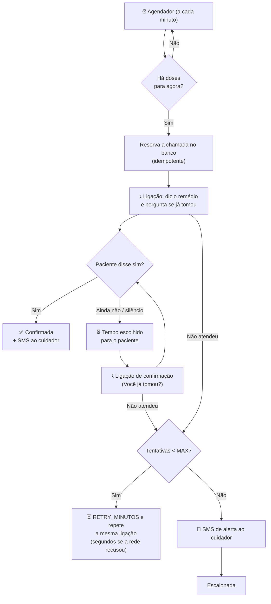

<div align="center">

# 💊 LembreMed

**URA (Unidade de Resposta Audível) que liga para o paciente na hora do remédio, confirma a tomada pela voz e avisa o cuidador por SMS.**


</div>

---

## 📖 Sobre o projeto

Muitos idosos e pacientes em tratamento contínuo esquecem de tomar os medicamentos no horário certo, e nem sempre usam smartphone ou aplicativos. O **LembreMed** resolve isso com a tecnologia mais acessível que existe: **uma ligação telefônica comum**.

No horário cadastrado, o sistema liga para o paciente:

> **08:00**
> 🤖 *"Olá, Dona Maria. Está na hora do seu remédio: Losartana, o comprimido redondo e rosa. Você já tomou?"*
> 👵 *"Ainda não."*
> 🤖 *"Tudo bem. Tome o seu remédio agora, por favor. Te ligo de novo em 5 minutos para confirmar. Até logo."*
>
> **08:05**
> 🤖 *"Olá, Dona Maria. Você já tomou o seu remédio, Losartana?"*
> 👵 *"Já tomei, sim."*
> 🤖 *"Obrigado! Até logo."*

Se ela já tivesse respondido "sim" às 08:00, seria uma ligação só. O tempo para ligar de novo (5 minutos no exemplo) é escolhido pelo cuidador para cada paciente.

O cuidador recebe na hora um SMS: *"LembreMed: Dona Maria confirmou o remédio das 08:00 (Losartana). Resposta: "Já tomei, sim.""*. Se o paciente não atender ou não confirmar, o sistema liga de novo e, esgotadas as tentativas, **manda um SMS de alerta ao cuidador**.

> Projeto desenvolvido como Projeto de Extensão (PEX).

**Sumário:** [Instalar em um PC](#-instalar-em-um-pc-novo) · [Uso no dia a dia](#-uso-no-dia-a-dia) · [Levar para outro PC](#-levar-para-outro-pc-com-os-dados) · [Problemas comuns](#-problemas-comuns) · [Limitações conhecidas](#-limitações-conhecidas) · [Contas (configuração única)](#-configuração-única-das-contas) · [Comandos](#-comandos) · [Variáveis](#-variáveis-de-ambiente-env) · [Como funciona](#-como-funciona) · [Estrutura](#-estrutura)

---

## 🚀 Instalar em um PC novo

São 4 passos, e só o último se repete no dia a dia. As contas da Twilio, do ngrok e do Google já estão criadas: você só precisa dos dados delas (o passo 3 diz onde achar cada um).

### 1. Instale os programas (uma vez por PC)

No Windows, abra o **PowerShell** e rode:

```powershell
winget install OpenJS.NodeJS.LTS
```

```powershell
winget install Git.Git
```

```powershell
winget install ngrok.ngrok
```

**Depois feche e abra o PowerShell de novo**: só assim ele passa a reconhecer `node`, `git` e `ngrok`. Para conferir, rode `node --version` (precisa ser 22 ou maior).

<details>
<summary>Mac ou Linux</summary>

No Mac, com o [Homebrew](https://brew.sh/): `brew install node git ngrok`. No Linux, instale o Node.js 22+ pelo [site oficial](https://nodejs.org/), o git pelo gerenciador de pacotes e o ngrok pelo [site do ngrok](https://ngrok.com/download). Os demais passos são iguais.
</details>

### 2. Baixe o projeto

```powershell
git clone https://github.com/cszinn/LembreMed.git
```

```powershell
cd LembreMed
```

```powershell
npm install
```

Se o GitHub pedir login, entre com uma conta que tenha acesso ao repositório.

### 3. Configure

```powershell
npm run configurar
```

O assistente pergunta cada dado, diz onde achar e grava tudo no arquivo `.env`. Ele confere o Account SID e o Auth Token na Twilio na hora e já sugere o número da conta.

| Ele pergunta | Onde achar |
| --- | --- |
| Account SID e Auth Token da Twilio | [console.twilio.com](https://console.twilio.com/), página inicial, quadro **Account Info** (clique em *Show* para ver o token) |
| Número da Twilio | Sugerido automaticamente; ou em **Phone Numbers > Manage > Active numbers** |
| Domínio fixo do ngrok | [dashboard.ngrok.com](https://dashboard.ngrok.com/) > **Domains** (ex.: `meu-nome.ngrok-free.dev`) |
| Authtoken do ngrok (só se este PC ainda não tiver) | [dashboard.ngrok.com](https://dashboard.ngrok.com/) > **Your Authtoken**, na **mesma conta** do domínio |
| ID do cliente Google | [console.cloud.google.com](https://console.cloud.google.com/) > **Google Auth Platform > Clientes** (termina em `.apps.googleusercontent.com`) |
| Ligar de verdade ou só simular | `s` liga de verdade; `n` só simula (bom para testar sem gastar) |

> [!TIP]
> **Atalho:** se você tem o arquivo `.env` de outro PC, copie ele para a pasta `LembreMed` e pule este passo. Só confira se o ngrok deste PC já tem o authtoken (rodar `npm run configurar` e apertar Enter em tudo resolve isso).

Pode rodar `npm run configurar` de novo quando quiser: Enter mantém o valor atual.

### 4. Ligue

```powershell
npm start
```

Esse comando abre o túnel do ngrok **e** o servidor, e confere pela internet se tudo responde. Quando estiver pronto, aparece:

```
==================================================================
 LembreMed no ar (ligações de verdade)
 Painel: https://meu-nome.ngrok-free.dev
         (neste PC também: http://localhost:3000)
 Deixe esta janela aberta. Para desligar: Ctrl+C
==================================================================
```

Abra o endereço do **Painel**, clique em **Fazer login com o Google** e, no primeiro acesso, informe o seu celular (é ele que recebe os SMS). Pronto: cadastre os pacientes.

> [!IMPORTANT]
> Rode o LembreMed em **um PC por vez**. O domínio do ngrok só pode estar aberto em um lugar; se estiver ligado em outro PC, o `npm start` avisa.

---

## 📅 Uso no dia a dia

- **Ligar:** `npm start` na pasta do projeto. **Desligar:** `Ctrl+C` na janela (ou fechar a janela).
- **Enquanto estiver ligado**, o PC precisa ficar **ligado, com internet e sem suspender**. No Windows: *Configurações > Sistema > Energia* e deixe "suspender" como **Nunca** quando estiver na tomada. Se o PC dormir na hora de uma dose, o sistema ainda liga quando acordar, desde que seja em até 10 minutos.
- **Cadastrar:** no painel, *Cadastrar Paciente* (nome e telefone com DDD) > *Adicionar Medicamento* (nome, descrição amigável e horários). A descrição é o que a assistente fala: escreva como o paciente reconhece o remédio, ex.: *"o comprimido redondo e rosa"*.
- **Testar uma ligação:** cadastre um horário 2 minutos à frente e espere. Para a apresentação, deixe o paciente com "ligar de novo em **1 minuto**" (no cadastro ou em *Editar Paciente*) para mostrar a segunda ligação sem esperar.
- **Pausar as ligações** de um paciente: chave *Pausar ligações* na página dele.
- **Histórico:** cada paciente mostra as últimas 20 ligações e, na coluna *Detalhe*, o que aconteceu ("Disse: 'já tomei'", "A rede recusou em 2s", "Tocou e ninguém atendeu"...).
- **Status da URA** (menu ☰ do painel): *Operacional*, *Simulação (não liga)* ou *Fora do ar (ngrok?)*, mais o resumo das ligações do dia.

**Como o sistema decide:** no horário, a ligação diz o remédio e pergunta "Você já tomou?". Se o paciente ainda não tomou, as próximas ligações só perguntam "Você já tomou o seu remédio, Losartana?".

| O paciente... | O que acontece |
| --- | --- |
| Diz um "sim" claro ("sim", "já", "já tomei", "tomei sim"...) | Dose confirmada, "Obrigado! Até logo." e **SMS ao cuidador** com a frase |
| Diz qualquer outra coisa ("ainda não", "vou tomar", algo sem sentido) | Conta como **não**: "Tudo bem. Tome o seu remédio agora, por favor. Te ligo de novo em 5 minutos para confirmar." Liga de novo depois do **tempo escolhido para o paciente** |
| Atende e fica em silêncio | "Não ouvi a sua resposta…" e liga de novo depois do tempo escolhido para o paciente |
| Não atende | Liga de novo depois de `RETRY_MINUTOS` |
| Cai na caixa postal ("deixe seu recado…") | Conta como **não atendida**: desliga sem deixar recado e repete a ligação completa depois de `RETRY_MINUTOS` |
| A rede recusa sem o telefone tocar | Religa em segundos (5, 10, 20, 40 e depois 60 s); as 6 primeiras recusas não contam como tentativa |
| Nunca atende (`MAX_TENTATIVAS` ligações) | **SMS de alerta ao cuidador**: "não conseguimos falar com…" |
| Atende mas nunca confirma (`MAX_TENTATIVAS` ligações de confirmação) | **SMS de alerta ao cuidador**: "não confirmou o remédio…" |

---

## 🔁 Levar para outro PC (com os dados)

Os dados (cuidadores, pacientes, remédios e histórico) ficam no arquivo `data/ura.sqlite`, que **não** vai para o GitHub.

1. No PC antigo, desligue o LembreMed (`Ctrl+C`).
2. Copie a pasta **`data`** e o arquivo **`.env`** (pendrive, Drive...).
3. No PC novo, faça os [passos 1 e 2](#-instalar-em-um-pc-novo), cole `data` e `.env` dentro da pasta `LembreMed` e rode `npm start`.

Sem copiar a pasta `data`, o sistema começa vazio: é só entrar com o Google e cadastrar de novo.

> [!CAUTION]
> O `.env` tem as senhas da Twilio: não mande por grupo nem publique. Ele e a pasta `data/` já estão no `.gitignore` e nunca vão para o GitHub.

---

## 🛟 Problemas comuns

| O que aparece | O que fazer |
| --- | --- |
| `node`, `npm`, `git` ou `ngrok` "não é reconhecido" | Feche e abra o PowerShell depois de instalar. Se continuar, instale de novo (passo 1). |
| `Falta o arquivo .env` | Rode `npm run configurar` (ou copie o `.env` de outro PC). |
| `[ngrok] Esse domínio já está aberto em outro lugar` | O LembreMed (ou um ngrok) está ligado em outro PC ou em outra janela. Feche lá e rode `npm start` de novo. |
| `[ngrok] ... sem o authtoken` ou `não pertence à conta` | Rode `npm run configurar` e cole o authtoken da conta do ngrok onde está o domínio. |
| `[ngrok] O ngrok não está instalado` | `winget install ngrok.ngrok`, feche e abra o PowerShell. |
| `Já existe outro servidor rodando` | Já tem um LembreMed aberto neste PC. Feche a outra janela (ou finalize `node.exe` no Gerenciador de Tarefas). |
| `[aviso] ... não respondeu pela internet` | O painel funciona só em `http://localhost:3000` e as ligações reais falham. Confira a internet e as mensagens `[ngrok]` acima do aviso. |
| Botão do Google dá erro ("origin", "acesso bloqueado") | O endereço do painel precisa estar em **Origens JavaScript autorizadas** no Google Cloud (veja [Google](#google-login-do-painel)). Depois de mudar, espere uns 5 minutos. |
| O painel mostra **Simulação (não liga)** | `DRY_RUN=true`. Rode `npm run configurar` e responda `s` em "ligar de verdade", depois `npm start` de novo. |
| A ligação não acontece no horário | Confira se o paciente não está pausado, se o horário está cadastrado no remédio certo e se o status da URA é *Operacional*. |
| O telefone não toca e o histórico mostra "A rede recusou em 3s" (várias vezes seguidas) | Em linhas **Vivo** é o **Vivo Anti Spam** barrando a ligação na rede, antes do celular (nem aparece chamada perdida). O sistema religa sozinho em segundos; para testar sem o bloqueio, veja [Limitações conhecidas](#-limitações-conhecidas). |
| O paciente disse "sim" mas não confirmou | Veja no histórico a frase que o sistema entendeu. Respostas curtas e claras ("sim", "já tomei") funcionam melhor. |
| O SMS não chegou | Veja em [console.twilio.com](https://console.twilio.com/) > **Monitor > Logs > Messaging** e confira o saldo. Teste com `node src/testar-alerta.js +5531999999999`. |
| Quero apagar tudo e começar do zero | Desligue o LembreMed e rode `npm run db:reset -- --confirmar`. |

---

## 🚧 Limitações conhecidas

### Vivo Anti Spam bloqueia parte das ligações

A Vivo tem um filtro, o **Vivo Anti Spam**, que fica **dentro da rede da operadora** e vem **ativado automaticamente em todas as linhas móveis**. Ele analisa o comportamento de quem liga e barra ligações com cara de automáticas ou em massa **antes de chegarem ao celular**. As ligações do LembreMed são automáticas, saem de um número dos EUA (+1) e se repetem em poucos minutos quando o paciente não confirma: exatamente o perfil que o filtro procura.

**Como aparece:** várias ligações seguidas são recusadas em uns 3 segundos, com o código **SIP 480**, e de vez em quando uma passa. No histórico do painel aparece "A rede recusou em 3s", e **no celular não aparece nenhuma chamada perdida**. Nos testes de outubro de 2026, isso aconteceu com só duas das linhas do grupo, e a que foi verificada é Vivo; as demais linhas tocaram normalmente. O sistema religa sozinho em segundos e, se todas falharem, o cuidador recebe o SMS de alerta normalmente: o problema é só a ligação não chegar.

**Para testar sem o bloqueio** (na linha Vivo que vai receber as ligações):

| Desativar | Reativar depois |
| --- | --- |
| SMS com a palavra **DESATIVAR** para **5050** | SMS com a palavra **ANTISPAM** para **5050** |
| ou: app **Vivo** > **Modo Seguro** > desativar | ou: pelo mesmo menu do app |
| ou: Central de Atendimento Vivo, **10315** | |

A Vivo informa que a mudança leva **até 24 horas** para valer. Com o filtro desligado, a linha volta a receber ligações de telemarketing.

**Na apresentação:** use um celular de outra operadora, ou uma linha Vivo com o Anti Spam desativado, e evite ligar várias vezes seguidas para o mesmo número logo antes.

**Em um uso real:** não dá para pedir a cada paciente que desative o filtro. A própria Vivo informa que **não bloqueia ligações com "Origem Verificada"** (padrão STIR/SHAKEN, que comprova quem está ligando). Isso exige ligar de um **número brasileiro** de uma empresa participante, o que na Twilio pede cadastro com **CNPJ**. Fica como próximo passo para levar o projeto além do protótipo.

Fontes: [Vivo, Anti Spam](https://vivo.com.br/para-voce/modo-seguro/anti-spam) · [Tecnoblog](https://tecnoblog.net/noticias/vivo-libera-sistema-anti-spam-gratis-para-todos-veja-como-ativar/) · [Teletime](https://teletime.com.br/14/08/2026/anatel-decide-que-vivo-anti-spam-e-legal-e-recomenda-modelo/)

### Número que aparece para o paciente

Com o `TWILIO_PHONE_NUMBER` dos EUA (+1), a Vivo recusou quase todas as ligações. A solução usada foi o `TWILIO_CALLER_ID`: um **celular brasileiro verificado** na Twilio (*Phone Numbers > Manage > Verified Caller IDs*), que passa a aparecer como número de quem liga. Com ele, as ligações para linhas Vivo tocaram de primeira (teste de 25/10/2026). Dois efeitos colaterais:

- Como a Twilio não tem rota própria dentro do Brasil, a ligação entra por uma operadora internacional, e alguns celulares mostram o país dessa rota (no teste, **"Países Baixos"**) junto do número.
- Se o paciente ligar de volta, cai no celular verificado (o de quem cuida do sistema).

Para tirar isso de vez, a ligação precisa sair de um provedor com rota nacional e número brasileiro próprio (por exemplo, um celular brasileiro exclusivo da Twilio, a Telnyx ou um provedor brasileiro).

### Outras

- **O PC precisa ficar ligado.** Sem hospedagem em nuvem, o LembreMed só liga enquanto o `npm start` estiver rodando.
- **Aviso do ngrok:** quem abre o painel pela primeira vez vê uma página do ngrok pedindo para clicar em **Visit Site**. É do plano grátis do ngrok e só some hospedando em outro lugar.
- **O link do painel é aberto:** qualquer pessoa com o endereço entra com uma conta Google e pode cadastrar pacientes, usando o crédito da Twilio. Compartilhe o link só com quem vai usar.

---

## 🔧 Configuração única das contas

Já feita para o grupo. Só refaça se trocar de conta.

### Twilio (ligações e SMS)

- Um número de telefone comprado na conta (formato `+1...`).
- **Permissões geográficas** de voz e SMS para o **Brasil** ativas (*Voice > Settings > Geo permissions* e *Messaging > Settings > Geo permissions*).
- Opcional: em *Phone Numbers > Active numbers > (número) > A call comes in*, coloque `https://SEU-DOMINIO.ngrok-free.dev/twilio/atendimento` para quem ligar **para** o número ouvir uma explicação.
- Na conta *trial*, só dá para ligar e mandar SMS para números verificados no console.

### ngrok (endereço público)

- Conta grátis com um **domínio fixo** (*Domains*). É o `BASE_URL` e o endereço do painel.
- A conta grátis aceita **um ngrok ligado por vez**.

### Google (login do painel)

O painel não tem senha: qualquer pessoa com o link entra com a conta do Google, e o primeiro acesso cria a conta de cuidador.

1. No [Google Cloud Console](https://console.cloud.google.com/), crie um projeto.
2. Em **Google Auth Platform**, configure a tela de consentimento como **Externo** (nome do app e e-mail de suporte). Em **Público**, clique em **Publicar aplicativo** (em modo "Teste" só entram os usuários de teste cadastrados).
3. Em **Clientes > Criar cliente**, escolha **Aplicativo da Web** e, em **Origens JavaScript autorizadas**, adicione `http://localhost:3000` e `https://SEU-DOMINIO.ngrok-free.dev` (sem barra no final). Deixe os URIs de redirecionamento vazios.
4. O **ID do cliente** vai no `GOOGLE_CLIENT_ID` (o `npm run configurar` pergunta). Se trocar o domínio do ngrok, adicione o novo nas origens.

---

## 🧰 Comandos

| Comando | Para que serve |
| --- | --- |
| `npm start` | **Uso normal:** abre o ngrok e o servidor juntos |
| `npm run configurar` | Cria ou altera o `.env` com perguntas |
| `npm run servidor` | Só o servidor, sem abrir o ngrok |
| `npm run dev` | Só o servidor, reiniciando sozinho a cada mudança no código (desenvolvimento) |
| `npm run db:seed` | Cria um paciente de exemplo (pausado) na primeira conta |
| `npm run db:reset -- --confirmar` | **Apaga todos os dados** e cria o banco vazio (com o LembreMed desligado) |
| `node src/testar-ligacao.js +5531999999999` | Dispara uma ligação real de teste (precisa de um horário cadastrado e do `npm start` rodando) |
| `node src/testar-alerta.js +5531999999999` | Manda um SMS real de teste |

---

## 🔑 Variáveis de ambiente (`.env`)

O `npm run configurar` preenche as principais. As outras podem ser editadas direto no `.env` (com o LembreMed desligado).

| Variável | Valor no `.env.example` | Descrição |
| --- | --- | --- |
| `TWILIO_ACCOUNT_SID` | — | SID da conta Twilio |
| `TWILIO_AUTH_TOKEN` | — | Token da conta Twilio (secreto) |
| `TWILIO_PHONE_NUMBER` | — | Número da Twilio que liga e manda SMS (`+1...`) |
| `TWILIO_CALLER_ID` | (vazio) | Opcional: número que aparece para o paciente nas ligações, ex.: um celular brasileiro verificado em *Phone Numbers > Manage > Verified Caller IDs*. O SMS continua saindo do `TWILIO_PHONE_NUMBER` |
| `BASE_URL` | — | Endereço público (domínio fixo do ngrok), usado pela Twilio e pelo painel |
| `GOOGLE_CLIENT_ID` | — | ID do cliente OAuth do Google (login do painel) |
| `DRY_RUN` | `true` | `true` só simula (não liga nem manda SMS); `false` liga de verdade |
| `MAX_TENTATIVAS` | `3` | Ligações sem atender (e, depois, ligações de confirmação) antes do alerta ao cuidador |
| `RETRY_MINUTOS` | `2` | Minutos para ligar de novo quando o paciente não atende (quando atende e ainda não tomou, vale o tempo escolhido no painel para cada paciente) |
| `VOZ` | `Polly.Camila-Neural` | Voz da ligação (outras: `Polly.Vitoria-Neural`, `Polly.Thiago-Neural`) |
| `VOZ_CONFIANCA_MINIMA` | `0.5` | Confiança mínima (0 a 1) para aceitar um "sim" falado |
| `APP_TZ` | `America/Sao_Paulo` | Fuso horário dos horários das doses |
| `PORT` | `3000` | Porta do servidor neste PC |
| `DB_PATH` | `./data/ura.sqlite` | Arquivo do banco de dados |
| `JWT_SECRET` | (gerado) | Assina o login do painel; o `configurar` gera um. Trocar desconecta todo mundo |
| `TWILIO_VALIDAR_ASSINATURA` | `true` | Só aceita webhooks assinados pela Twilio. Mantenha `true` |

---

## ✨ Funcionalidades

- 📞 **Ligação automática** no horário de cada medicamento, com voz neural em pt-BR (Amazon Polly via Twilio).
- 🗣️ **Ligação curta e dinâmica**: no horário, diz qual remédio tomar (agrupando vários do mesmo horário: "Primeiro: …, Segundo: …") e pergunta "Você já tomou?". Se ainda não tomou, liga de novo só para confirmar, no tempo que o cuidador escolheu para aquele paciente (1 a 30 minutos).
- 🎙️ **Confirmação por voz**: o paciente responde do jeito que quiser. Só um "sim" claro confirma; qualquer outra frase conta como "não", sem repetir a pergunta.
- 🔁 **Retentativas**: liga de novo após `RETRY_MINUTOS`, até `MAX_TENTATIVAS`. Recusas rápidas da rede (o telefone nem toca) são religadas em segundos e as 6 primeiras não contam.
- 🚨 **SMS ao cuidador**: alerta quando as tentativas acabam e aviso de confirmação com a frase dita.
- 🛡️ **Agendamento idempotente**: no máximo uma ligação por dose, dia e tentativa, mesmo com reinícios. Doses dos últimos 10 minutos perdidas (servidor fora do ar, PC dormindo) ainda são lembradas.
- 🩺 **Diagnóstico**: status da Twilio, código SIP, tempo até a recusa e a frase do paciente ficam gravados, e o histórico explica cada ligação.
- 🖥️ **Painel do cuidador** com login pelo Google, status real da URA e resumo do dia.
- 🔒 **Segurança**: webhooks só com assinatura da Twilio, sem senhas guardadas, limite de tentativas de login e telefones restritos ao Brasil.
- 🧪 **Modo simulação** (`DRY_RUN=true`) para testar tudo sem ligar de verdade.

---

## 🔄 Como funciona



**Ciclo de vida de uma chamada** (`chamadas.status`):

| Status | Significado |
| --- | --- |
| `discando` | Ligação disparada, aguardando o resultado |
| `confirmada` | O paciente disse "sim" |
| `sem_resposta` | Não atendeu, ocupado, respondeu outra coisa ou ficou em silêncio |
| `falhou` | Erro ao discar (ex.: ngrok fora do ar) ou falha na operadora |
| `escalonada` | Tentativas esgotadas, cuidador avisado |

Cada chamada também guarda o `tipo` (`lembrete`: diz o remédio e pergunta; `confirmacao`: só pergunta), `atendida`, `twilio_status`, `sip_code`, `duracao_seg`, `toque_seg` (segundos até a recusa, quando não atendida) e `resposta` (a frase que o paciente falou).

### Tecnologias

| Camada | Tecnologia |
| --- | --- |
| Backend | Node.js 22+ e Express 5 |
| Banco | SQLite (`better-sqlite3`), criado automaticamente |
| Agendamento | `node-cron` |
| Telefonia | Twilio Programmable Voice (reconhecimento de fala pt-BR) e SMS |
| Login | Google Identity Services (`google-auth-library`) |
| Frontend | HTML, Bootstrap e JavaScript puro (`public/`) |
| Endereço público | ngrok (domínio fixo grátis) |

---

## 📁 Estrutura

```
.
├── public/                       # Painel do cuidador (frontend estático)
│   ├── index.html
│   ├── css/style.css
│   └── js/app.js
├── src/
│   ├── iniciar.js                # npm start: abre o ngrok e inicia o servidor
│   ├── configurar.js             # npm run configurar: assistente que monta o .env
│   ├── server.js                 # Servidor Express + agendadores
│   ├── config.js                 # Leitura do .env
│   ├── validators.js             # Validação de nomes, telefones (Brasil) e horários
│   ├── db/
│   │   ├── schema.sql            # Tabelas: cuidadores, pacientes, medicamentos, horarios, chamadas
│   │   ├── index.js              # Conexão SQLite (cria as tabelas que faltarem)
│   │   ├── reset.js              # Apaga o banco e cria um vazio
│   │   └── seed.js               # Paciente de exemplo
│   ├── middleware/
│   │   └── twilioAssinatura.js   # Valida o X-Twilio-Signature dos webhooks
│   ├── routes/
│   │   ├── auth.js               # Login com Google e perfil do cuidador
│   │   ├── api.js                # API REST do painel (exige login)
│   │   └── twilio.js             # Webhooks da ligação (roteiro, resposta, status)
│   ├── services/
│   │   ├── scheduler.js          # Agendador que dispara as ligações
│   │   ├── escalonamento.js      # Resultado das ligações, retentativas e SMS
│   │   ├── interpretarResposta.js# Entende se a fala do paciente é um "sim"
│   │   ├── mensagem.js           # Monta o texto falado
│   │   ├── telephony.js          # Disparo de ligações (real ou simulado)
│   │   ├── alerta.js             # Envio de SMS
│   │   ├── auth.js               # Token de sessão do painel
│   │   ├── google.js             # Confere a credencial do "Entrar com Google"
│   │   └── twilioClient.js       # Cliente Twilio compartilhado
│   ├── testar-ligacao.js         # Script: dispara uma ligação de teste
│   └── testar-alerta.js          # Script: envia um SMS de teste
├── .env.example                  # Modelo do .env (comentado)
└── package.json
```

### API REST

**Autenticação** (`/api/auth`): `GET /opcoes` (ID do cliente Google), `POST /google` (troca a credencial do Google pelo token do painel), `GET /me`, `PUT /perfil` (nome e celular). As demais rotas exigem o cabeçalho `Authorization: Bearer <token>` e só mostram os pacientes do cuidador logado.

| Método | Rota | Descrição |
| --- | --- | --- |
| `GET` | `/api/estatisticas` | Status da URA e resumo das ligações de hoje |
| `GET` | `/api/pacientes` | Lista pacientes |
| `GET` | `/api/pacientes/:id` | Paciente com medicamentos e horários |
| `GET` | `/api/pacientes/:id/chamadas` | Últimas 20 ligações do paciente |
| `POST` | `/api/pacientes` | Cria paciente |
| `PUT` | `/api/pacientes/:id` | Atualiza paciente (nome, telefone, ativo) |
| `DELETE` | `/api/pacientes/:id` | Remove paciente |
| `POST` | `/api/pacientes/:id/medicamentos` | Adiciona medicamento (com horários) |
| `PUT` | `/api/medicamentos/:id` | Atualiza medicamento |
| `DELETE` | `/api/medicamentos/:id` | Remove medicamento |
| `POST` | `/api/medicamentos/:id/horarios` | Adiciona horário (`HH:MM`) |
| `DELETE` | `/api/horarios/:id` | Remove horário |

**Webhooks da Twilio** (`/twilio`): `POST /voz` (roteiro da ligação; `/atendimento` responde quem liga para o número), `POST /digito` (fala do paciente), `POST /sem-digito` (atendeu e não falou) e `POST /status` (fim da ligação: status e código SIP). Há também `GET /health`.

---

## 🗺️ Próximos passos

- [x] Mostrar no painel o motivo de cada ligação não atendida
- [ ] Relatório de adesão ao tratamento (doses confirmadas por semana)
- [ ] Termo de consentimento (LGPD)
- [ ] Hospedar em nuvem, para funcionar sem um PC ligado
- [ ] Ligar de um número brasileiro com "Origem Verificada" (exige CNPJ), para não ser barrado por filtros anti-spam como o da Vivo

## 📄 Licença

Distribuído sob a licença **ISC**.

---

<div align="center">
Feito com 💙 para quem cuida de quem a gente ama.
</div>
