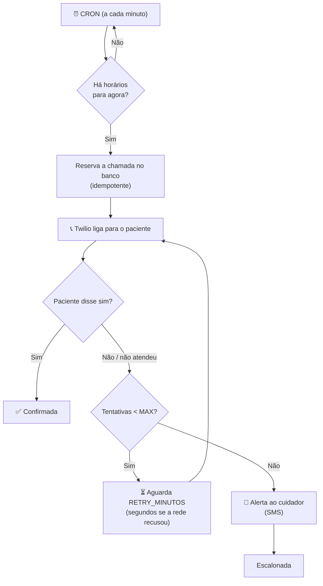

<div align="center">

# 💊 LembreMed

**URA (Unidade de Resposta Audível) que liga para o paciente na hora do remédio, confirma a tomada pela voz ("sim") e avisa o cuidador quando ninguém responde.**


</div>

---

## 📖 Sobre o projeto

Muitos idosos e pacientes em tratamento contínuo esquecem de tomar os medicamentos no horário certo — e nem sempre usam smartphone ou aplicativos. O **LembreMed** resolve isso com a tecnologia mais acessível que existe: **uma ligação telefônica comum**.

No horário cadastrado, o sistema liga para o paciente e uma voz em português diz qual remédio tomar, descrevendo-o de forma amigável (ex.: *"o comprimido redondo e rosa"*). O paciente confirma **respondendo "sim"**. Se não atender ou não confirmar, o sistema tenta de novo e, esgotadas as tentativas, **envia um alerta por SMS para o cuidador**. Quando o paciente confirma, o cuidador também recebe um SMS com a frase que ele falou.

> Projeto desenvolvido como Projeto de Extensão (PEX).

## ✨ Funcionalidades

- 📞 **Ligação automática** no horário de cada medicamento, com voz neural em pt-BR (Amazon Polly via Twilio).
- 🗣️ **Mensagem dinâmica**: agrupa vários remédios do mesmo horário numa única ligação ("Primeiro: …, Segundo: …").
- 🎙️ **Confirmação por voz**: a assistente só pergunta "Você já tomou?" e o paciente responde do jeito que quiser (reconhecimento de fala pt-BR). Só um "sim" claro ("sim", "já tomei", "tomei sim"...) confirma; qualquer outra frase conta como "não" e o sistema liga de novo mais tarde. A ligação é curta: não repete a pergunta.
- 🔁 **Retentativas configuráveis**: liga de novo após X minutos, até N tentativas. Se a rede recusa a ligação em poucos segundos (o telefone nem toca), religa em segundos (5, 10, 20, 40 e depois a cada 60 s) e as 6 primeiras recusas desse tipo não gastam tentativa.
- 🚨 **Escalonamento ao cuidador** por SMS quando as tentativas acabam.
- ✅ **Aviso de confirmação**: quando o paciente diz que tomou, o cuidador recebe um SMS com a frase dita (ex.: *"já tomei sim"*).
- 🛡️ **Agendamento idempotente**: cada horário gera no máximo uma chamada por dia/tentativa, mesmo com reinícios do servidor. Horários dos últimos 10 minutos perdidos (servidor fora do ar, PC dormindo) ainda são lembrados.
- 🩺 **Diagnóstico de entrega**: o status final da Twilio, o código SIP, o tempo até a recusa e a frase do paciente ficam gravados em cada chamada, e o histórico do painel explica cada ligação ("a rede recusou", "tocou e ninguém atendeu", "disse: …").
- 🖥️ **Painel do cuidador** (web) com login pela **conta do Google**, para cadastrar pacientes, medicamentos e horários e ver o histórico de ligações.
- 🔒 **Segurança**: webhooks só aceitos com assinatura da Twilio, login só pela conta do Google (sem senhas guardadas no sistema), limite de tentativas e telefones restritos ao Brasil.
- 🧪 **Modo simulação (`DRY_RUN`)** para testar todo o fluxo sem fazer ligações reais.

## 🔄 Como funciona



**Ciclo de vida de uma chamada** (`chamadas.status`):

| Status         | Significado                                                   |
| -------------- | ------------------------------------------------------------- |
| `discando`     | Ligação disparada, aguardando resultado                       |
| `confirmada`   | Paciente disse "sim"                                          |
| `sem_resposta` | Não atendeu, ocupado, disse "não" ou atendeu sem responder    |
| `falhou`       | Erro ao discar (ex.: ngrok fora do ar) ou falha na operadora  |
| `escalonada`   | Tentativas esgotadas, cuidador avisado                        |

Cada chamada também guarda `twilio_status`, `sip_code`, `duracao_seg` e `toque_seg` (segundos até a recusa, quando não atendida) e `resposta` (a última frase que o paciente falou).

## 🛠️ Tecnologias

| Camada        | Tecnologia                                   |
| ------------- | -------------------------------------------- |
| Backend       | Node.js + Express 5                          |
| Banco         | SQLite (`better-sqlite3`)                    |
| Agendamento   | `node-cron`                                  |
| Telefonia     | Twilio Programmable Voice + SMS              |
| Frontend      | HTML + Bootstrap + JavaScript puro (`public/`) |
| Túnel local   | ngrok (para expor os webhooks da Twilio)     |

## 📁 Estrutura

```
.
├── public/                       # Painel do cuidador (frontend estático)
│   ├── index.html
│   ├── css/style.css
│   └── js/app.js
├── src/
│   ├── server.js                 # Ponto de entrada (Express + agendadores)
│   ├── config.js                 # Leitura das variáveis de ambiente
│   ├── validators.js             # Validação de nomes, telefones (Brasil) e horários
│   ├── db/
│   │   ├── schema.sql            # Tabelas: cuidadores, pacientes, medicamentos, horarios, chamadas
│   │   ├── index.js              # Conexão SQLite (cria as tabelas que faltarem)
│   │   ├── reset.js              # Apaga o banco e cria um vazio
│   │   └── seed.js               # Dados de exemplo
│   ├── middleware/
│   │   └── twilioAssinatura.js   # Valida o X-Twilio-Signature dos webhooks
│   ├── routes/
│   │   ├── auth.js               # Login com Google e perfil do cuidador
│   │   ├── api.js                # API REST do painel (exige login)
│   │   └── twilio.js             # Webhooks de voz e de status da ligação
│   ├── services/
│   │   ├── scheduler.js          # CRON que dispara as ligações
│   │   ├── escalonamento.js      # Resultado das ligações, retentativas e alerta
│   │   ├── interpretarResposta.js# Entende "sim" / "não" na fala do paciente
│   │   ├── mensagem.js           # Monta o texto falado
│   │   ├── telephony.js          # Disparo de ligações (real ou simulado)
│   │   ├── alerta.js             # SMS para o cuidador
│   │   ├── auth.js               # Token de sessão do painel
│   │   ├── google.js             # Confere a credencial do "Entrar com Google"
│   │   └── twilioClient.js       # Cliente Twilio compartilhado
│   ├── testar-ligacao.js         # Script: dispara uma ligação de teste
│   └── testar-alerta.js          # Script: envia um SMS de teste
├── .env.example
└── package.json
```

## 🚀 Como rodar

### Pré-requisitos

- [Node.js](https://nodejs.org/) 22 ou superior
- Conta na [Twilio](https://www.twilio.com/) com um número de telefone e a permissão geográfica do Brasil ativa
- [ngrok](https://ngrok.com/) (ou outro túnel) para a Twilio alcançar seu servidor local
- Um projeto no [Google Cloud Console](https://console.cloud.google.com/) para o login com Google (gratuito)

### Instalação

```bash
git clone https://github.com/cszinn/LembreMed.git
cd LembreMed
npm install
cp .env.example .env      # no Windows: copy .env.example .env
```

Edite o `.env` com suas credenciais (veja a tabela abaixo) e então:

```bash
npm run dev               # cria o banco (se não existir) e inicia com recarga automática
```

Acesse o painel em **http://localhost:3000**, clique em **Entrar com Google**, informe o seu celular (recebe os SMS) e cadastre os pacientes. Para ter dados de exemplo, rode `npm run db:seed` depois de criar a conta (o paciente de exemplo entra pausado).

### Login com Google

O painel não tem senha: qualquer pessoa com o link entra com a conta do Google, e o primeiro acesso cria a conta de cuidador.

1. No [Google Cloud Console](https://console.cloud.google.com/), crie um projeto.
2. Em **APIs e serviços > Tela de consentimento OAuth**, escolha **Externo**, preencha o nome do app e o e-mail de suporte e clique em **Publicar aplicativo** (em modo "Teste" só entram os usuários de teste cadastrados).
3. Em **Credenciais > Criar credenciais > ID do cliente OAuth**, escolha **Aplicativo da Web** e, em **Origens JavaScript autorizadas**, adicione `http://localhost:3000` e o endereço do ngrok (`https://SEU-DOMINIO.ngrok-free.dev`).
4. Copie o ID do cliente para `GOOGLE_CLIENT_ID` no `.env`.

No primeiro acesso o painel pede o celular do cuidador, que recebe os SMS.

Para apagar todos os dados e começar com o banco vazio (com o servidor parado): `npm run db:reset -- --confirmar`.

### Expondo os webhooks

Em outro terminal, use o domínio fixo gratuito do ngrok (o mesmo do `BASE_URL`):

```bash
ngrok http --url=SEU-DOMINIO.ngrok-free.dev 3000
```

Antes de cada ligação o servidor confere se `BASE_URL/health` responde; se o ngrok estiver desligado, a ligação não é feita (fica como `falhou` e é tentada de novo), em vez de o paciente ouvir um erro em inglês.

> [!IMPORTANT]
> Rode apenas **um** servidor por vez. Se a porta já estiver em uso, o segundo processo encerra com aviso.

## ⚙️ Variáveis de ambiente

| Variável                    | Padrão                 | Descrição                                                        |
| --------------------------- | ---------------------- | ---------------------------------------------------------------- |
| `PORT`                      | `3000`                 | Porta do servidor                                                |
| `BASE_URL`                  | —                      | URL pública (ngrok) usada nos webhooks da Twilio                 |
| `TWILIO_ACCOUNT_SID`        | —                      | SID da conta Twilio                                              |
| `TWILIO_AUTH_TOKEN`         | —                      | Token de autenticação da Twilio                                  |
| `TWILIO_PHONE_NUMBER`       | —                      | Número Twilio que fará as ligações (formato `+1...`)             |
| `DB_PATH`                   | `./data/ura.sqlite`    | Caminho do arquivo SQLite (relativo à pasta do projeto)          |
| `DRY_RUN`                   | `true`                 | `true` simula as ligações; `false` liga de verdade               |
| `APP_TZ`                    | `America/Sao_Paulo`    | Fuso horário usado pelo agendador                                |
| `VOZ`                       | `Polly.Camila-Neural`  | Voz usada nas ligações                                           |
| `MAX_TENTATIVAS`            | `3`                    | Número máximo de ligações antes de avisar o cuidador             |
| `RETRY_MINUTOS`             | `5`                    | Intervalo entre tentativas                                       |
| `TWILIO_VALIDAR_ASSINATURA` | `true`                 | Só aceita webhooks assinados pela Twilio                         |
| `JWT_SECRET`                | (gerado)               | Assina a sessão do painel; vazio = gerado e guardado em `data/.jwt_secret` |
| `GOOGLE_CLIENT_ID`          | —                      | ID do cliente OAuth do Google (login do painel)                  |
| `VOZ_CONFIANCA_MINIMA`      | `0.5`                  | Confiança mínima (0 a 1) para aceitar um "sim" falado            |

> [!CAUTION]
> Nunca faça commit do arquivo `.env` nem da pasta `data/`. Ambos já estão no `.gitignore`.

## 🔌 API REST

**Autenticação** (`/api/auth`): `GET /opcoes` (ID do cliente Google), `POST /google` (troca a credencial do Google pelo token do painel), `GET /me`, `PUT /perfil` (nome e celular). As demais rotas exigem o cabeçalho `Authorization: Bearer <token>` e só mostram os pacientes do cuidador logado.

| Método   | Rota                               | Descrição                                   |
| -------- | ---------------------------------- | ------------------------------------------- |
| `GET`    | `/api/estatisticas`                | Resumo do cuidador e das ligações de hoje   |
| `GET`    | `/api/pacientes`                   | Lista pacientes                             |
| `GET`    | `/api/pacientes/:id`               | Detalha paciente com medicamentos/horários  |
| `GET`    | `/api/pacientes/:id/chamadas`      | Últimas 20 ligações do paciente             |
| `POST`   | `/api/pacientes`                   | Cria paciente                               |
| `PUT`    | `/api/pacientes/:id`               | Atualiza paciente                           |
| `DELETE` | `/api/pacientes/:id`               | Remove paciente                             |
| `POST`   | `/api/pacientes/:id/medicamentos`  | Adiciona medicamento (com horários)         |
| `PUT`    | `/api/medicamentos/:id`            | Atualiza medicamento                        |
| `DELETE` | `/api/medicamentos/:id`            | Remove medicamento                          |
| `POST`   | `/api/medicamentos/:id/horarios`   | Adiciona horário (`HH:MM`)                  |
| `DELETE` | `/api/horarios/:id`                | Remove horário                              |

**Webhooks da Twilio** (`/twilio`): `POST /voz` (roteiro da ligação; `/atendimento` responde quem liga para o número), `POST /digito` (resposta do paciente), `POST /sem-digito` (atendeu sem responder) e `POST /status` (fim da ligação: status e código SIP).

Há também `GET /health` para verificação de saúde do servidor.

## 🧪 Testes manuais

```bash
# Dispara uma ligação real para o número informado (servidor e ngrok precisam estar no ar)
node src/testar-ligacao.js +5531999999999

# Envia um SMS de teste para o número informado
node src/testar-alerta.js +5531999999999

```

> [!NOTE]
> Na conta trial da Twilio, só é possível ligar e enviar mensagens para números previamente verificados no console.

## 🗺️ Próximos passos

- [x] Mostrar no painel o motivo de cada ligação não atendida (rede recusou, não atendeu, disse "não")
- [ ] Relatórios de adesão ao tratamento
- [ ] Deploy em nuvem com banco gerenciado

## 📄 Licença

Distribuído sob a licença **ISC**.

---

<div align="center">
Feito com 💙 para quem cuida de quem a gente ama.
</div>
