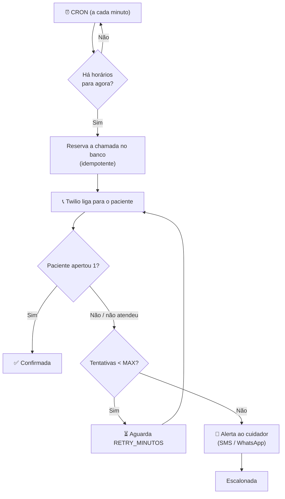

<div align="center">

# 💊 LembreMed

**URA (Unidade de Resposta Audível) que liga para o paciente na hora do remédio, confirma a tomada pelo teclado do telefone e avisa o cuidador quando ninguém responde.**


</div>

---

## 📖 Sobre o projeto

Muitos idosos e pacientes em tratamento contínuo esquecem de tomar os medicamentos no horário certo — e nem sempre usam smartphone ou aplicativos. O **LembreMed** resolve isso com a tecnologia mais acessível que existe: **uma ligação telefônica comum**.

No horário cadastrado, o sistema liga para o paciente e uma voz em português diz qual remédio tomar, descrevendo-o de forma amigável (ex.: *"o comprimido redondo e rosa"*). O paciente confirma apertando **1** no teclado. Se não atender ou não confirmar, o sistema tenta de novo e, esgotadas as tentativas, **envia um alerta por SMS ou WhatsApp para o cuidador**.

> Projeto desenvolvido como Projeto de Extensão (PEX).

## ✨ Funcionalidades

- 📞 **Ligação automática** no horário de cada medicamento, com voz neural em pt-BR (Amazon Polly via Twilio).
- 🗣️ **Mensagem dinâmica**: agrupa vários remédios do mesmo horário numa única ligação ("Primeiro: …, Segundo: …").
- 🔢 **Confirmação por tecla (DTMF)**: o paciente aperta 1 e a tomada fica registrada.
- 🔁 **Retentativas configuráveis**: liga de novo após X minutos, até N tentativas.
- 🚨 **Escalonamento ao cuidador** por SMS ou WhatsApp quando o paciente não confirma.
- 🛡️ **Agendamento idempotente**: cada horário gera no máximo uma chamada por dia/tentativa, mesmo com reinícios do servidor.
- 🖥️ **Painel do cuidador** (web) para cadastrar pacientes, medicamentos e horários.
- 🧪 **Modo simulação (`DRY_RUN`)** para testar todo o fluxo sem fazer ligações reais.

## 🔄 Como funciona



**Ciclo de vida de uma chamada** (`chamadas.status`):

| Status         | Significado                                                   |
| -------------- | ------------------------------------------------------------- |
| `discando`     | Ligação disparada, aguardando resultado                       |
| `confirmada`   | Paciente apertou 1                                            |
| `sem_resposta` | Não atendeu, ocupado ou atendeu sem apertar nada              |
| `falhou`       | Erro ao discar ou ligação cancelada/falha na operadora        |
| `escalonada`   | Tentativas esgotadas, cuidador avisado                        |

## 🛠️ Tecnologias

| Camada        | Tecnologia                                   |
| ------------- | -------------------------------------------- |
| Backend       | Node.js + Express 5                          |
| Banco         | SQLite (`better-sqlite3`)                    |
| Agendamento   | `node-cron`                                  |
| Telefonia     | Twilio Programmable Voice + SMS/WhatsApp     |
| Frontend      | HTML + JavaScript puro (`public/`)           |
| Túnel local   | ngrok (para expor os webhooks da Twilio)     |

## 📁 Estrutura

```
.
├── public/                  # Painel do cuidador (frontend estático)
│   ├── index.html
│   └── js/app.js
├── src/
│   ├── server.js            # Ponto de entrada (Express + agendadores)
│   ├── config.js            # Leitura das variáveis de ambiente
│   ├── validators.js        # Validação de nomes, telefones e horários
│   ├── db/
│   │   ├── schema.sql       # Tabelas: pacientes, medicamentos, horarios, chamadas
│   │   ├── index.js         # Conexão SQLite
│   │   ├── init.js          # Cria o banco
│   │   └── seed.js          # Dados de exemplo
│   ├── routes/
│   │   ├── api.js           # API REST do painel
│   │   └── twilio.js        # Webhooks de voz (roteiro, dígito, sem dígito)
│   ├── services/
│   │   ├── scheduler.js     # CRON que dispara as ligações
│   │   ├── escalonamento.js # Acompanhamento, retentativas e alerta
│   │   ├── mensagem.js      # Monta o texto falado
│   │   ├── telephony.js     # Disparo de ligações (real ou simulado)
│   │   ├── alerta.js        # SMS / WhatsApp para o cuidador
│   │   └── twilioClient.js  # Cliente Twilio compartilhado
│   ├── testar-ligacao.js    # Script: dispara uma ligação de teste
│   └── testar-alerta.js     # Script: envia um alerta de teste
├── .env.example
└── package.json
```

## 🚀 Como rodar

### Pré-requisitos

- [Node.js](https://nodejs.org/) 22 ou superior
- Conta na [Twilio](https://www.twilio.com/) com um número de telefone (a conta trial funciona para testes)
- [ngrok](https://ngrok.com/) (ou outro túnel) para a Twilio alcançar seu servidor local

### Instalação

```bash
git clone https://github.com/cszinn/LembreMed.git
cd LembreMed
npm install
cp .env.example .env      # no Windows: copy .env.example .env
```

Edite o `.env` com suas credenciais (veja a tabela abaixo) e então:

```bash
npm run db:init           # cria o banco SQLite
npm run db:seed           # (opcional) insere dados de exemplo
npm run dev               # inicia com recarga automática
```

Acesse o painel em **http://localhost:3000**.

### Expondo os webhooks

Em outro terminal:

```bash
ngrok http 3000
```

Copie a URL gerada (ex.: `https://abc123.ngrok-free.dev`) para a variável `BASE_URL` do `.env` e reinicie o servidor.

## ⚙️ Variáveis de ambiente

| Variável              | Padrão                 | Descrição                                                        |
| --------------------- | ---------------------- | ---------------------------------------------------------------- |
| `PORT`                | `3000`                 | Porta do servidor                                                |
| `BASE_URL`            | —                      | URL pública (ngrok) usada nos webhooks da Twilio                 |
| `TWILIO_ACCOUNT_SID`  | —                      | SID da conta Twilio                                              |
| `TWILIO_AUTH_TOKEN`   | —                      | Token de autenticação da Twilio                                  |
| `TWILIO_PHONE_NUMBER` | —                      | Número Twilio que fará as ligações (formato `+1...`)             |
| `DB_PATH`             | `./data/ura.sqlite`    | Caminho do arquivo SQLite                                        |
| `DRY_RUN`             | `true`                 | `true` simula as ligações; `false` liga de verdade               |
| `APP_TZ`              | `America/Sao_Paulo`    | Fuso horário usado pelo agendador                                |
| `VOZ`                 | `Polly.Camila-Neural`  | Voz usada nas ligações                                           |
| `MAX_TENTATIVAS`      | `3`                    | Número máximo de ligações antes de avisar o cuidador             |
| `RETRY_MINUTOS`       | `5`                    | Intervalo entre tentativas                                       |
| `ALERTA_CANAL`        | `sms`                  | `sms` ou `whatsapp`                                              |
| `WHATSAPP_FROM`       | `+14155238886`         | Remetente do WhatsApp (sandbox da Twilio por padrão)             |

> [!CAUTION]
> Nunca faça commit do arquivo `.env`. Ele já está no `.gitignore`.

## 🔌 API REST

Base: `/api`

| Método   | Rota                               | Descrição                                   |
| -------- | ---------------------------------- | ------------------------------------------- |
| `GET`    | `/pacientes`                       | Lista pacientes                             |
| `GET`    | `/pacientes/:id`                   | Detalha paciente com medicamentos/horários  |
| `POST`   | `/pacientes`                       | Cria paciente                               |
| `PUT`    | `/pacientes/:id`                   | Atualiza paciente                           |
| `DELETE` | `/pacientes/:id`                   | Remove paciente                             |
| `POST`   | `/pacientes/:id/medicamentos`      | Adiciona medicamento (com horários)         |
| `PUT`    | `/medicamentos/:id`                | Atualiza medicamento                        |
| `DELETE` | `/medicamentos/:id`                | Remove medicamento                          |
| `POST`   | `/medicamentos/:id/horarios`       | Adiciona horário (`HH:MM`)                  |
| `DELETE` | `/horarios/:id`                    | Remove horário                              |

<details>
<summary><b>Exemplo: cadastrar paciente e medicamento</b></summary>

```bash
curl -X POST http://localhost:3000/api/pacientes \
  -H "Content-Type: application/json" \
  -d '{
    "nome": "Dona Maria",
    "telefone": "(31) 98888-7777",
    "cuidador_nome": "João",
    "cuidador_telefone": "(31) 97777-6666"
  }'

curl -X POST http://localhost:3000/api/pacientes/1/medicamentos \
  -H "Content-Type: application/json" \
  -d '{
    "nome": "Losartana",
    "descricao": "o comprimido redondo e branco",
    "horarios": ["08:00", "20:00"]
  }'
```

</details>

**Webhooks da Twilio** (`/twilio`): `POST /voz` (roteiro da ligação), `POST /digito` (tecla pressionada) e `POST /sem-digito` (atendeu sem responder).

Há também `GET /health` para verificação de saúde do servidor.

## 🧪 Testes manuais

```bash
# Dispara uma ligação real para o número informado
node src/testar-ligacao.js +5531999999999

# Envia um alerta de teste (SMS/WhatsApp) para o número informado
node src/testar-alerta.js +5531999999999
```

> [!NOTE]
> Na conta trial da Twilio, só é possível ligar e enviar mensagens para números previamente verificados no console.

## 🗺️ Próximos passos

- [ ] Reativar a validação de assinatura dos webhooks da Twilio fora do ambiente de testes
- [ ] Autenticação no painel do cuidador
- [ ] Relatórios de adesão ao tratamento
- [ ] Deploy em nuvem com banco gerenciado

## 📄 Licença

Distribuído sob a licença **ISC**.

---

<div align="center">
Feito com 💙 para quem cuida de quem a gente ama.
</div>
